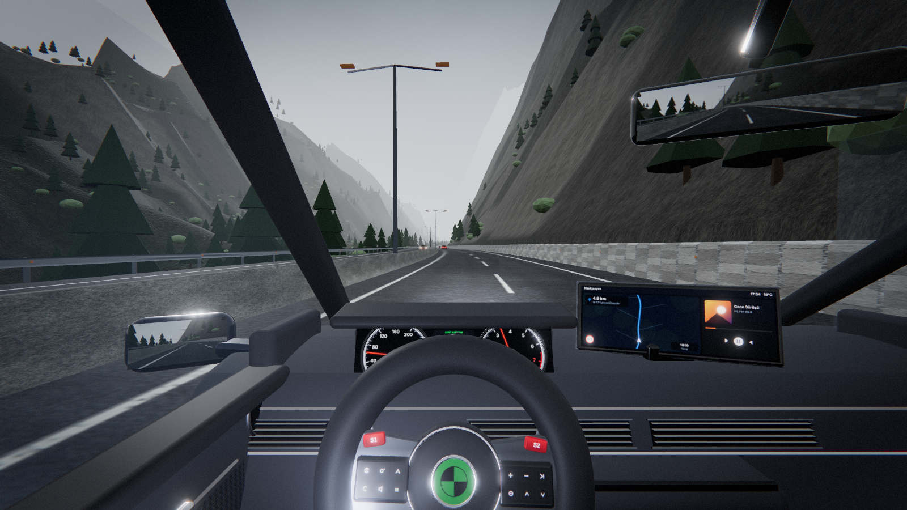
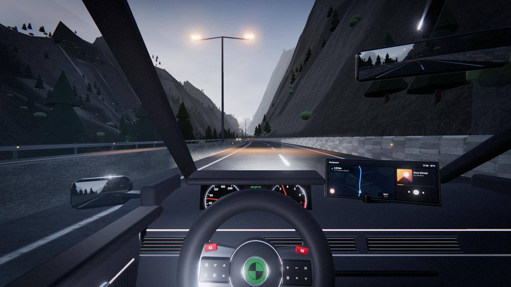
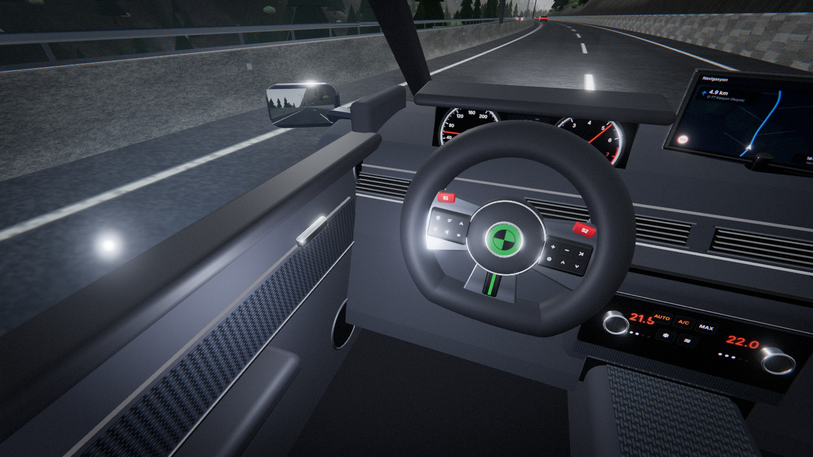
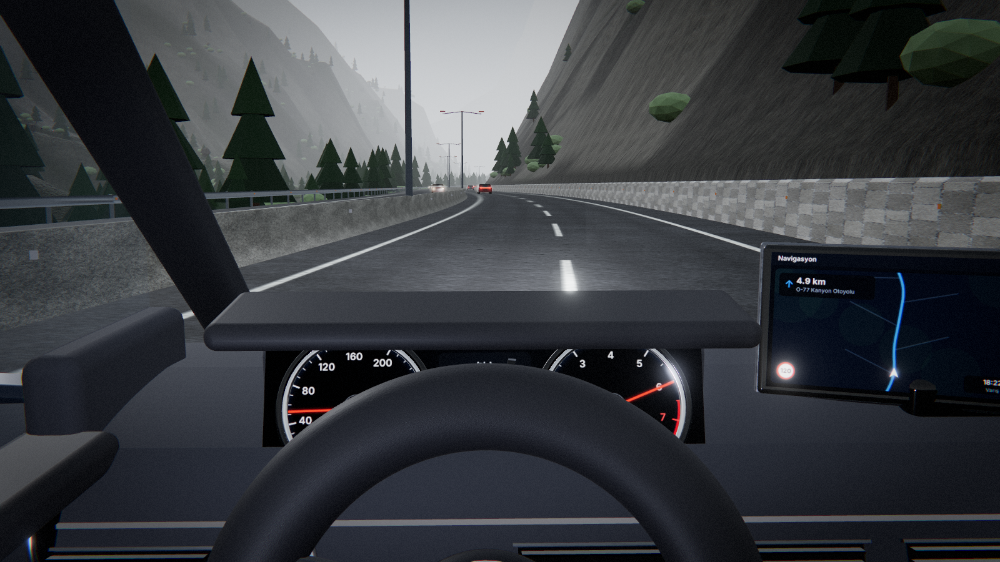
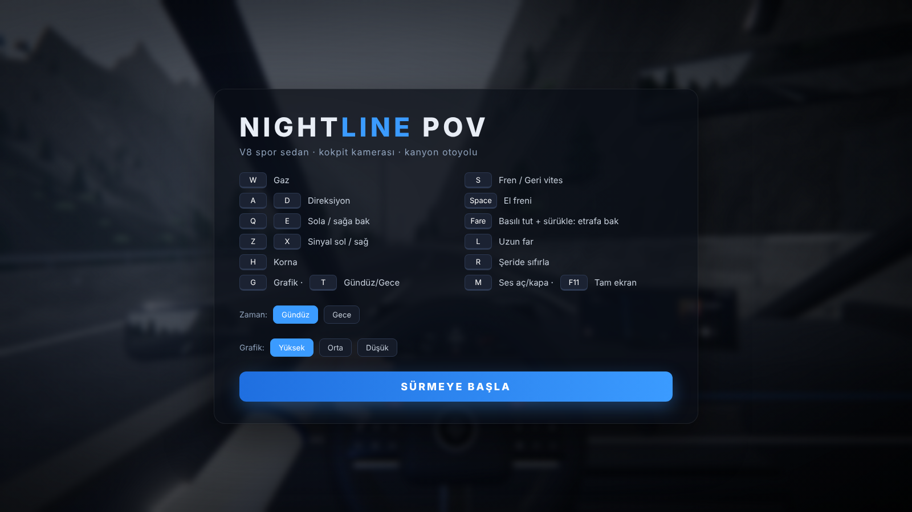

# NightLine POV

Windows için **birinci şahıs (kokpit kamerası) araba sürüş oyunu**. V8 motorlu bir Alman tarzı süper sedanla kanyon otoyolunda sür: çift kadranlı gösterge, ayrı duran orta ekran, karbon/krom detaylı kokpit, çalışan aynalar, gündüz ve gece modu, trafik ve sentezlenmiş V8 sesi.

Oyunda tek kamera modu vardır: sürücü koltuğundan bakış.



## Ekran görüntüleri

| Gece modu | Orta konsol |
|---|---|
|  |  |





## Özellikler

- **Gerçekçi kokpit:** kaput altında çift kadranlı gösterge (hız + devir, ortada bilgi ekranı), panonun üstünde ayrı duran orta ekran, çift havalandırma ızgarası, düğme sırası, düğmeli klima paneli, karbon fiber ve gümüş trimler, ince ışık şeridi
- **Direksiyon:** kalın deri jant, yeşil/siyah özgün logolu yuvarlak göbek, gümüş kollarda düğme panelleri, kırmızı S1/S2 sürüş modu tuşları, vites kulakçıkları; gerçek direksiyon oranıyla döner
- **Gündüz / Gece modu:** kapalı-sisli gündüz ya da alacakaranlık gecesi (menüden veya T tuşuyla)
- **Çalışan aynalar:** dikiz aynası ve iki yan ayna arkayı gerçek zamanlı gösterir
- **Canlı gösterge:** hız, devir, vites (D1–D8 / R), güç, şerit asistanı görünümü (öndeki araçlar), sinyaller, uzun far, yakıt, saat
- **Navigasyon ekranı:** gerçek yol geometrisinden çizilen, aracın yönüne göre dönen harita
- **Fizik:** 8 ileri otomatik şanzıman, tork eğrisi, çekiş sınırı, yanal tutuş, el freni ile kayma, yokuş etkisi, bariyer çarpışmaları (0–100 km/s ≈ 3,5 sn, azami 305 km/s)
- **Gövde hareketi:** frende burun dalışı, gazda kalkış, virajda yatma, hıza bağlı titreşim, çarpışmada sarsıntı
- **Sonsuz kanyon otoyolu:** prosedürel kayalık yamaçlar, ağaçlar, istinat duvarı, refüj bariyeri, bariyer reflektörleri, sokak lambaları
- **Trafik:** aynı yönde ve karşı yönde giden araçlar, stop lambaları ve far parlaması
- **Far:** kısa farda gerçek kesme çizgisi, uzun far (L), trafik araçlarına gölge
- **Ses (WebAudio):** V8 motor sesi, vites geçişi, rüzgâr/yol uğultusu, lastik sesi, korna, sinyal tık sesi
- **Görüntü:** ACES ton eşleme, bloom, vinyet, film grain, hafif renk sapması (GoPro havası)
- **Grafik kalitesi:** Yüksek / Orta / Düşük (G tuşu)

## Kontroller

| Tuş | İşlev |
|---|---|
| **W** / ↑ | Gaz |
| **S** / ↓ | Fren (dururken basılı tutunca geri vites) |
| **A** / **D** | Direksiyon |
| **Space** | El freni |
| **Q** / **E** | Sola / sağa bak |
| Fare (basılı tut + sürükle) | Etrafa bak |
| **Z** / **X** | Sol / sağ sinyal |
| **L** | Uzun far |
| **H** | Korna |
| **R** | Şeride sıfırla |
| **G** | Grafik kalitesi |
| **T** | Gündüz / Gece |
| **M** | Ses aç/kapa |
| **F11** | Tam ekran |
| **Esc** | Menü / duraklat |

## İndir ve oyna (Windows)

[Actions](../../actions) sekmesinde son başarılı **Build Windows** çalışmasını aç, `NightLinePOV-windows` dosyasını indir. İçinde iki seçenek var:

- `NightLinePOV-1.0.0-portable.exe` — kurulum gerektirmez, çift tıkla çalışır
- `NightLinePOV-1.0.0-setup.exe` — kurulum sihirbazı

`v1.0.0` gibi bir etiket gönderilirse exe dosyaları otomatik olarak **Releases** sayfasına da eklenir.

## Kaynaktan çalıştırma

```bash
npm install
npm start          # oyunu derler ve Electron penceresinde açar
npm run dist       # Windows exe üretir (release/ klasörü)
```

Tarayıcıda denemek için `npm run build` sonrası `index.html` dosyasını açman yeterli.

## Teknik

- **Three.js** (WebGL) – tüm modeller ve dokular kodla (prosedürel) üretilir, dışarıdan model/doku dosyası yoktur
- **esbuild** – `src/` klasörünü tek dosyaya paketler (`dist/game.js`)
- **Electron + electron-builder** – Windows masaüstü uygulaması
- **GitHub Actions** – her push'ta Windows exe derlemesi

```
src/
  main.js      oyun döngüsü, girişler, kamera, post-processing, aynalar
  cockpit.js   kokpit modeli (pano, kavisli ekran, direksiyon, kapılar, kaput)
  screens.js   gösterge / navigasyon / medya / klima ekran çizimleri
  car.js       araç fiziği ve şanzıman
  world.js     gökyüzü, ışıklar, sonsuz yol parçaları, arazi, bitki örtüsü
  road.js      yol geometrisi ve arazi yükseklik fonksiyonu
  traffic.js   trafik araçları
  audio.js     sentezlenmiş motor ve efekt sesleri
  textures.js  prosedürel dokular (asfalt, karbon, deri, taş...)
```

> Araç ve marka tamamen özgün tasarımdır; gerçek bir otomobil markasının logosu veya tasarımı kullanılmamıştır.

## Lisans

MIT
